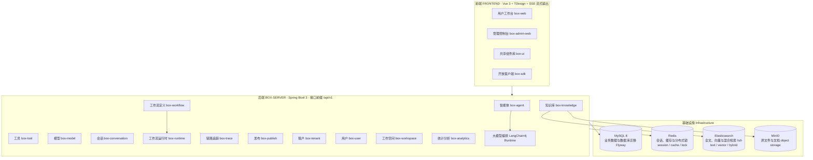

# 架构图 Architecture

矢量图：[`assets/architecture.svg`](./assets/architecture.svg)

V1 采用 **模块化单体 Modular Monolith**：前端多应用共用 `@box/ui`，后端一个 Spring Boot 进程按领域模块拆分。

| 层 Layer | 内容 |
|----------|------|
| 接入 Access | `box-web`、`box-admin-web`、Open API / Embed / `box-sdk` |
| 应用 Application | 单进程 `box-server`：对话在 `box-agent`（`AgentChatExecutor`），工作流节点在 `box-runtime`（`WorkflowExecutor`） |
| 存储 Storage | MySQL 库名 `box`、Redis 前缀 `box:`、Elasticsearch、MinIO |
