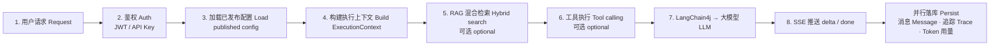
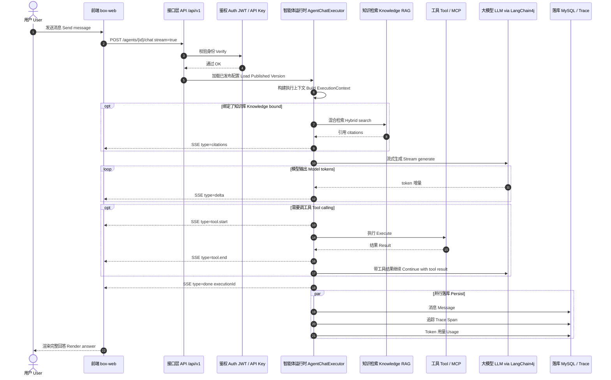

# 智能体对话 Agent Chat

矢量图：[`assets/flow-agent-chat.svg`](./assets/flow-agent-chat.svg)

生产环境只读 **已发布版本 Published Version**。  
接口 Endpoint：`POST /api/v1/agents/{id}/chat`  
实现 Implementation：`box-agent` · `AgentChatExecutor`

## 流程图 Flow

## 时序图 Sequence

## SSE 事件 Events

| type | 中文 | English |
|------|------|---------|
| `citations` | RAG 引用列表 | RAG citation list |
| `delta` | 回答文本增量 | Answer text chunk |
| `tool.start` / `tool.delta` / `tool.end` | 工具调用生命周期 | Tool call lifecycle |
| `tool.confirm` | 危险工具需用户确认 | Dangerous tool confirmation |
| `done` | 流结束，含 executionId | Stream complete |
| `error` | 错误信息 | Error |
