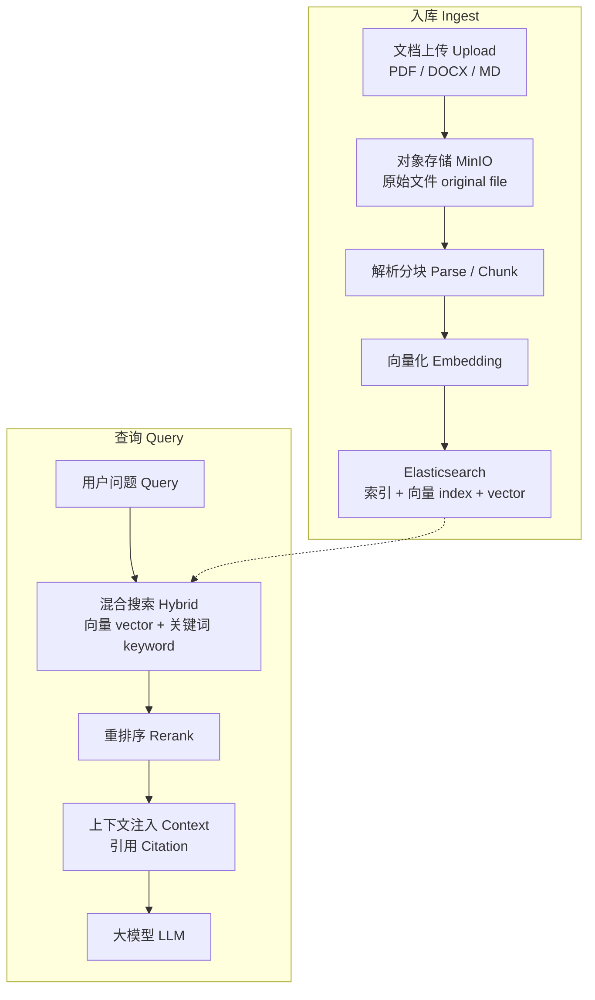

# 知识库管线 RAG

矢量图：[`assets/flow-rag.svg`](./assets/flow-rag.svg)

业务元数据在 MySQL，原文件在 MinIO，搜索与向量由 Elasticsearch 承担。

文档状态机 Document status：`UPLOADING → PARSING → CHUNKING → EMBEDDING → INDEXING → READY / FAILED`。
