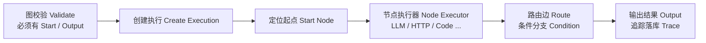
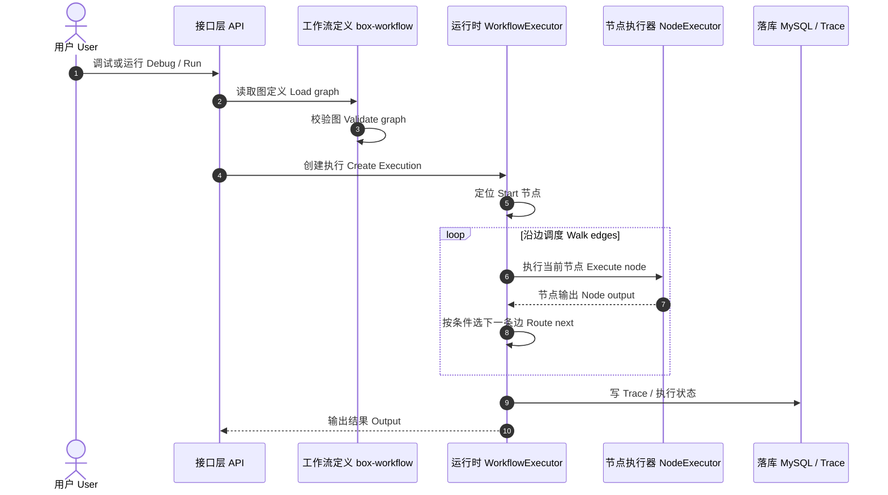

# 工作流执行引擎 Workflow Runtime

矢量图：[`assets/flow-workflow.svg`](./assets/flow-workflow.svg)

图定义与运行时分离。节点执行采用 **策略 + 注册表 Strategy + Registry**。  
实现 Implementation：`box-runtime` · `WorkflowExecutor`

## 时序图 Sequence

节点类型 Node types：Start / Input / Output / LLM / Agent / Knowledge / HTTP / Condition / Switch / Loop / Code / Variable / Template。
