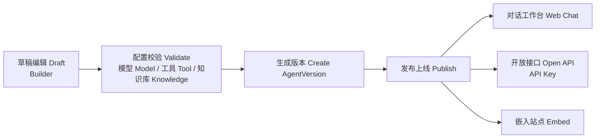

# 配置与发布生命周期 Lifecycle

矢量图：[`assets/flow-lifecycle.svg`](./assets/flow-lifecycle.svg)

草稿 Draft 与已发布 Published 严格隔离。生产只跑已发布版本。

运行时分工 Runtime split：

- 对话 Chat：`box-agent` · `AgentChatExecutor`
- 工作流 Workflow：`box-runtime` · `WorkflowExecutor`
